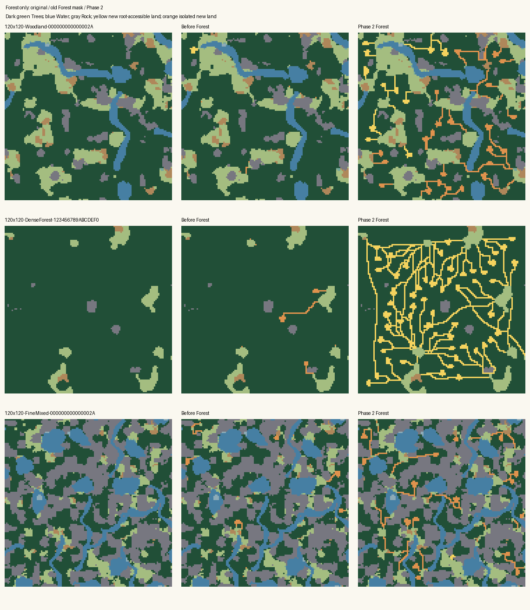

# Forest enrichment Phase 2 measurements

Measured 12 November 2026 against the original Forest implementation and the
Phase 2 implementation. Forest-only access improves substantially in the paired
Session B corpus, particularly in large dense formations. The improvement costs
additional bounded search work, runtime and temporary allocations. It does not
establish universal connectivity or successful gameplay.

## Paired high-intensity outcomes

These totals cover the same 45 worlds before and after. Ordinary land access
retains the original principal component's top-left root, even if another
component later becomes larger.

| Measurement | Before | Phase 2 |
|---|---:|---:|
| Original Trees made traversable | 3,210 | 16,963 |
| New Cells reaching the retained root | 1,640 | 13,069 |
| Previously disconnected existing ground reaching that root | 380 | 6,527 |
| Features with accessible anchors and usable area ≥4 | 60 / 198 | 399 / 590 |
| Previously disconnected natural clearings reaching that root | 3 | 78 |
| Remaining Trees at current depth ≥6 | 36,119 | 2,727 |
| Maximum remaining Forest depth | 30 | 12 |
| Largest remaining exact cardinal Tree mass | 13,418 | 5,296 |
| Trees more than five cardinal steps from retained-root ground | 99,229 | 46,839 |
| Nominal disturbance budget used | 3,210 / 20,470 (15.7%) | 16,963 / 20,470 (82.9%) |
| Occupied 4×4 formation bins receiving an edit | 449 / 1,785 | 841 / 1,785 |

New accessible Cells increase 8.0×; 77.0% of new traversable Cells reach the
retained root, up from 51.1%. No high-intensity world loses accessible new Cells
relative to its paired baseline. Those findings do not require every optional
pocket to join the largest region. At high intensity, 191 feature anchors still
lie outside the retained-root component. Fine Mixed remains particularly
fragmented: only 485 of its 2,275 new traversable Cells reach that root.

The exact Session B dense-Forest stress reference is seed `123456789ABCDEF0`
at (37,-29), rather than seed 42. Of its 13,512 original Trees, the old Forest
pass removed only 94 and connected none of those Cells to the retained root.
Phase 2 removes 2,395 Trees, connects all 2,395 new Cells and 587 previously
disconnected ground Cells, and leaves 11,117 Trees. Maximum remaining depth falls
from 28 to 8; depth-6-or-deeper Trees fall from 8,944 to 470. Its exact recipe is:

```text
WLD1-120x120-X37-Y-29-F85-W0-R5-KBroad-HAuto-E1-I3-B1000-OEmpty-S123456789ABCDEF0
```

A remaining limitation is Fine Mixed seed 42 at (-17,-13). It opens 557 Trees
versus 120 before, but only 9 new Cells reach the retained root, versus 0 before;
no previously disconnected existing ground is connected. Remaining maximum
Forest depth improves from 6 to 5, yet Water/Rock fragmentation still limits
ordinary land access. This is a useful local Forest improvement with little
improvement to that particular reference region, rather than evidence of a
universal connection guarantee:

```text
WLD1-120x120-X-17-Y-13-F35-W20-R35-KFine-HMixed-E1-I3-B1000-OEmpty-S000000000000002A
```

| Size, 15 worlds each | Traversable Cells before → after | Accessible new Cells before → after | Old ground newly connected before → after |
|---|---:|---:|---:|
| 30×24 | 311 → 675 | 309 → 675 | 0 → 33 |
| 60×50 | 1,237 → 2,768 | 840 → 2,542 | 380 → 987 |
| 120×120 | 1,662 → 13,520 | 491 → 9,852 | 0 → 5,507 |

| Intensity, 45 worlds each | Traversable Cells before → after | Accessible new Cells before → after | Old ground newly connected before → after |
|---|---:|---:|---:|
| Low | 2,322 → 8,484 | 1,256 → 5,880 | 36 → 3,634 |
| Medium | 2,922 → 13,477 | 1,585 → 10,201 | 380 → 6,248 |
| High | 3,210 → 16,963 | 1,640 → 13,069 | 380 → 6,527 |

All 45 disabled scenario fingerprints remain unchanged. All 180 configurations
on each revision produced deterministic scenario fingerprints and identical
feature, entrance and opportunity metadata across the five measured repetitions.
Every generation, including warmups, passed production Engine creation and
validation. No non-Forest original Cell changed in any measured configuration.

The historical Session B report combines Forest and Rock. This run deliberately
disables Rock, Water and Grassland enrichment, so its anchored feature totals
must not be compared directly with combined-family totals: later Rock excavation
can connect Forest features. In particular, 60 Forest anchors here versus 62 in
the combined analysis reflects that separation. The original Forest excavation
total of 3,210 Cells agrees.

## Runtime, allocations and work

Debug/.NET 10.0.12, tiered compilation disabled for measurement processes only.
Each configuration has two warmups and five samples. These are cumulative
current-thread allocations, not retained memory. The following high-intensity
totals sum each case's median; they are not a single elapsed batch measurement.

| Cost across 45 high-intensity cases | Before | Phase 2 |
|---|---:|---:|
| Full generation, sum of case medians | 2,744 ms | 4,269 ms |
| Full generation, median case | 28.4 ms | 31.6 ms |
| Full generation, sum of median allocated bytes | 900.7 MB | 1,126.9 MB |
| Forest stage, sum of medians | 423 ms | 2,148 ms |
| Forest stage, sum of median allocated bytes | 126.6 MB | 349.7 MB |
| Routing searches | 430 | 1,755 |
| Routing visited work | 68,452 | 990,131 |

Full generation costs 55.5% more time and 25.1% more allocations in these totals.
The disabled controls sum to 2,342 ms before and 2,141 ms after (8.6% lower),
showing ordinary measurement variation. Timing is machine dependent; no timing
value governs deterministic generation decisions.

The slowest final high-intensity case is 120×120 Dense Forest, seed 42: median
727 ms and 158.2 MB allocated. Maximum recorded high-intensity routing work is
421,900 visited Cells in that same case, below the Forest stage's two-million-work ceiling. This
records route/shortcut search work; it does not count every candidate-selection
or depth-refresh operation.

For the 15 high-intensity 120×120 worlds specifically, the median case increases
from 144.3 to 159.0 ms; median allocated bytes increase from 45.6 to 49.1 MB.
Those size-specific medians avoid letting the 30×24 cases dominate the typical
case cost. Two exact reproducible examples at offset (-17,-13), seed 42:

| Recipe | Trees opened before → after | Accessible new Cells before → after | Remaining maximum depth before → after | Generation median before → after |
|---|---:|---:|---:|---:|
| Woodland recipe below | 31 → 979 | 19 → 291 | 14 → 7 | 144 → 237 ms |
| Dense Forest recipe below | 234 → 2,353 | 99 → 2,353 | 30 → 8 | 131 → 727 ms |

```text
WLD1-120x120-X-17-Y-13-F60-W8-R8-KBalanced-HAuto-E1-I3-B1000-OEmpty-S000000000000002A
WLD1-120x120-X-17-Y-13-F85-W0-R5-KBroad-HAuto-E1-I3-B1000-OEmpty-S000000000000002A
```

An initial implementation exhibited much larger dense-Forest costs. Its run was
stopped after 150 completed configurations; it is not included in the final
performance table. Indexed exclusion masks and precomputed cardinal neighbors
removed repeated candidate-list scans. Every one of those 150 paired
configurations retained exactly the same scenario fingerprint and full
quality/work measurements after optimization. This equality applies only to
that intermediate access-only revision. Final bounded trail guidance deliberately
changes paths and fingerprints; the final tables and repository evidence were
regenerated from a new complete 180-case run after that change.

## Method and reproduction

The source harness and commands are in
[tools/forest-enrichment-probe](../tools/forest-enrichment-probe/README.md).
[results.json](../tools/forest-enrichment-probe/results.json) retains intensity,
size and style aggregates, all 45 high-intensity paired outcomes and scenario
fingerprints, runtime/build settings, assembly hashes and final Forest source
hashes. Baseline revision: `c58b3714be432282fdda2afd061904cf6add4754`.
[evidence.jsonl](../tools/forest-enrichment-probe/evidence.jsonl) additionally
retains compact scalar outcomes and measured costs for all 180 paired cases;
the documented reproduction command verifies all stable evidence fields.
Full local JSONL and archived measurement binaries are under
`.tmp/forest-phase2/`: `before.jsonl`, `after.jsonl`,
`after-first-partial.jsonl`, `after-access.jsonl`, `after-guided.jsonl`,
`comparison.json` and `before-provenance.json`.
The scratch artifacts are not required to run the repository harness again.

The corpus is exactly Session B's three sizes, five terrain styles and three
seed/offset pairs. Each world runs disabled/low/medium/high, with Forest as its
only enrichment family and no Civilization, routes or Population. Public
`WorldGenerator.Generate` APIs supply both final state and per-stage cost
measurements. No copied production algorithm or alternate execution path is used.

Depth uses production cardinal family-depth analysis, including crop-edge
seeding. Spatial bins measure distribution of edits, rather than claiming every
Cell in a touched bin is accessible. The five-step distance field is a sight
distance proxy, not Engine LOS or Fog of War. Useful feature space means an
accessible anchor and reported usable area ≥4; it does not assert encounter,
Loot, Hero placement, movement allowance or complete large-Unit-footprint access.
The nominal budget uses each eligible original Forest's unchanged integer cap
`CoreArea * (3 + intensity * 5) / 100`; bounds and percentages are not increased
to obtain these results.

The dedicated probe built with zero warnings/errors before both complete runs.
The comparison script verified complete 180-case pairing and unchanged disabled
fingerprints. Independent rerun of `--verify-evidence` matched all 180 compact
records. The implementation's initial focused Forest/analysis/pipeline suite
passed 37 tests, with a further 29 affected fixture-migration tests passing.
The final guided implementation's focused suite passed 34 tests. Its full .NET
rerun passed 3,492 Engine and 780 Web tests (4,272 total). The full solution
build succeeded in `.playwright-cli` with one cached NU1900
vulnerability-feed warning and no package changes. Ordinary output was blocked
by DLL locks from the preserved running Web host. The initial Node suite had
nine Python-launcher failures; all 19 tests in the seven affected files passed
after selecting the installed interpreter with `PROJECTDELVE_PYTHON`. Remaining
Node and dispatcher checks passed in the initial run.

The measurements ran on a shared machine. Earlier intermediate measurements
had occasional short build/test overlap; planned builds/tests were held during
the final guided benchmark. These are observational cost comparisons, not controlled latency
claims. The disabled control difference above helps characterize that variation.
This corpus remains advisory evidence, not a replacement for mechanic tests or
a new generation acceptance requirement.

## Visual QA



The three rows show Woodland seed 42, the exact historical dense-Forest stress
seed, and the remaining problematic Fine Mixed seed 42. Yellow edits reach the
retained root; orange edits remain outside it. The old Forest mask comes from
Session B's map with every original non-Tree Cell restored, excluding Rock
excavation. Mask totals and anchored new-Cell counts match the paired production
measurements. [Rendering instructions](../tools/forest-enrichment-probe/README.md)
describe the optional archived-map dependency.

Direct image inspection confirms branched trails, small irregular clearings and
substantial retained Forest, rather than broad uniform thinning. An intermediate
access-only version had conspicuous long axis-aligned runs and rectangular
loops; rotating its cost field did not improve that appearance. Final bounded
trail guidance produces more varied diagonal stair-step branches and irregular
loops while retaining cardinal physical paths. Straight links still occur, but
the inspected dense network no longer has the same rectangular-grid appearance.
Fine Mixed visibly retains extensive Water/Rock barriers
and many isolated new orange paths, consistent with its nine anchored new Cells.

## Follow-up boundary

The measured Forest improvement supports moving to the next independently
reviewed phase while retaining the explicit runtime tradeoff and optional
disconnected regions. Rock requires its existing compatibility decision first:
the choice between preserving narrowly viable dungeon opportunities and changing
which earlier excavations a dungeon planner may absorb must be explicit. These
Forest-only measurements provide no evidence for broadening Rock disturbance,
changing dungeon semantics, or introducing a late construction pass.
