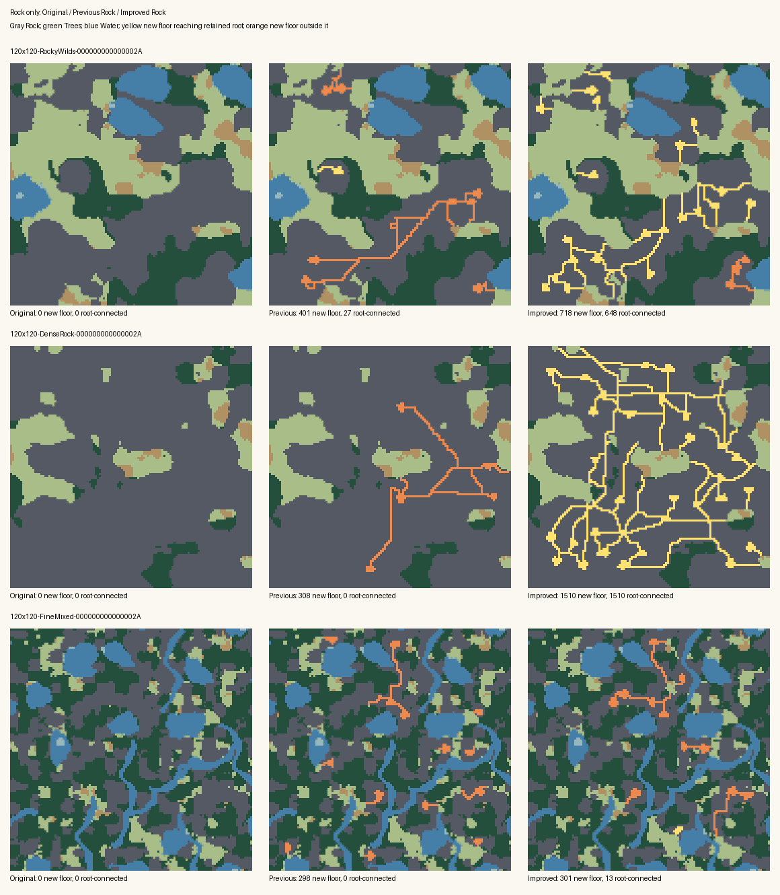

# Rock Enrichment and Mountain Dungeon compatibility

Measured 12 November 2026 in the normal main repository. Rock selection now
creates substantially more accessible interior exploration under the original
7/10/13% ceilings. Mountain Dungeons can reuse eligible earlier floor while
retaining complete shells, ownership checks and the remaining-connected-mass
limit. No tunnel refilling, late enrichment, final repair, Forest changes,
population balancing, Quick Play policy or gameplay rules were added.

## Paired Rock-only terrain results

The same 45 Session B worlds run disabled/Low/Medium/High, for 180 configurations
per revision. The baseline already includes Forest Phase 2 and Accessibility
Analysis V1; Forest is disabled in this terrain comparison. The reference region
retains the top-left Cell of the original largest ordinary land component.

| High intensity, 45 worlds | Before | This phase |
|---|---:|---:|
| Original Solid Rock made traversable | 3,927 | 8,889 |
| New floor reaching the retained reference root | 913 | 7,694 |
| Previously disconnected existing ground reaching that root | 599 | 9,074 |
| Accessible cave anchors with usable area at least seven | 31 / 119 | 193 / 245 |
| Second-mouth/pass features | 15 | 99 |
| Previously disconnected natural clearings reaching the root | 0 | 23 |
| Remaining Rock at current depth at least six | 17,483 | 3,458 |
| Maximum remaining Rock depth | 25 | 9 |
| Largest remaining exact cardinal Rock mass | 11,183 | 2,802 |
| Rock more than five cardinal steps from reference ground | 70,334 | 34,834 |
| Nominal disturbance budget used | 3,927 / 9,940 (39.5%) | 8,889 / 9,940 (89.4%) |
| Occupied 4x4 formation bins receiving an edit | 295 / 1,125 | 359 / 1,125 |

86.6% of new floor reaches the retained root, versus 23.2% before. These are
geographic authoring measurements, not legal Moves, LOS, FoW or a promise that
every optional cave joins Quick Play's eventual start. Fifty-two new cave anchors
remain outside the reference region. Baseline second mouths were not tested for
shortcut benefit; all 99 new pass features passed either a distinct-component
connection check or a measured walk-shortening check. Some reuse an earlier
mouth, so the feature need not record two *new* entrances.

| Size, 15 high-intensity worlds each | New floor | Root-connected new floor | Old ground newly connected |
|---|---:|---:|---:|
| 30x24 | 109 → 132 | 93 → 132 | 7 → 63 |
| 60x50 | 752 → 1,210 | 438 → 1,029 | 215 → 392 |
| 120x120 | 3,066 → 7,547 | 382 → 6,533 | 377 → 8,619 |

| Intensity, 45 worlds each | New floor | Root-connected new floor | Old ground newly connected |
|---|---:|---:|---:|
| Low | 3,323 → 4,791 | 739 → 4,007 | 446 → 7,703 |
| Medium | 3,780 → 6,885 | 909 → 5,944 | 599 → 8,722 |
| High | 3,927 → 8,889 | 913 → 7,694 | 599 → 9,074 |

All 45 disabled fingerprints are unchanged. All 180 configurations on each
revision have deterministic scenario fingerprints and feature/entrance/opportunity
metadata across five measured repetitions. Every warmup and sample passed Engine
creation. No original non-Rock Cell changed in this Rock-only corpus.

Two high-intensity cases lose root-connected new floor: 60x50 Rocky Wilds seed42
falls 49→21 and 60x50 Fine Mixed seed42 falls 15→0. The latter retains its dungeon
instead of carving the narrowly viable mass. Woodland 120x120 seed42 also makes
less floor (33→12), with zero root-connected new floor in both versions, and its
remaining maximum Rock depth rises 4→5. These losses remain in the evidence;
aggregate improvements are not per-map monotonic guarantees.

## Reproducible large examples

All three examples use seed `2A`, offset (-17,-13), Rock only, high intensity.
Changing `E1` to `E0` gives the natural control under the current code. Reproducing
the old enriched result requires the archived baseline implementation.

```text
WLD1-120x120-X-17-Y-13-F15-W8-R50-KBroad-HMixed-E1-I3-B0100-OEmpty-S000000000000002A
WLD1-120x120-X-17-Y-13-F5-W0-R85-KBroad-HAuto-E1-I3-B0100-OEmpty-S000000000000002A
WLD1-120x120-X-17-Y-13-F35-W20-R35-KFine-HMixed-E1-I3-B0100-OEmpty-S000000000000002A
```

| Example | New floor | Root-connected new floor | Maximum remaining depth |
|---|---:|---:|---:|
| Rocky Wilds | 401 → 718 | 27 → 648 | 10 → 8 |
| Dense Rock | 308 → 1,510 | 0 → 1,510 | 23 → 9 |
| Fine Mixed | 298 → 301 | 0 → 13 | 6 → 5 |

The Dense Rock case retains 10,257 of its 11,767 original Rock Cells, opens access
to 976 previously disconnected ground Cells and leaves 913 Rock Cells at depth
six or greater. Fine Mixed remains highly fragmented despite useful local caves.



Direct inspection confirms broader interior coverage, branches, loops and
substantial retained Rock. It also shows remaining long cardinal segments and
some rectangular loops in the dense stress case; the soft guide reduces but does
not eliminate that visual limitation. Fine Mixed still shows predominantly
disconnected orange caves, matching its thirteen root-connected new Cells.

## Dungeon compatibility and access regressions

The planner first retains its intact-rock search, then tries an absorbable mask
when necessary. Original exact Solid Rock provenance only supplies candidate
floor. Current permissions remain authoritative. Connected remaining Rock masses
are still distinct; original logical formation identity never permits excavating
another mass. A touching natural-floor branch must be absorbed completely or the
candidate rejected. Its final shell must be complete, including diagonals and
crop boundaries, with only the accepted exterior mouth. Earlier floor remains
floor, including during optional Lava placement.

The two confirmed Fine Mixed losses are reproduced with these exact recipes:

```text
WLD1-30x24-X0-Y0-F35-W20-R35-KFine-HMixed-E1-I3-B0100-C1-NLow-VMedium-P2-OEmpty-S0000000000000001
WLD1-60x50-X-17-Y-13-F35-W20-R35-KFine-HMixed-E1-I3-B0100-C1-NLow-VMedium-P2-OEmpty-S000000000000002A
```

Their disabled controls (`E0`, `B0000`) each place one dungeon. The previous
Rock pass places zero; this phase places one. A minimum-two-position guard alone
failed the second case: capacity dropped 3→2 but the real profile/layout search
could still fit only one room. The delivered guard retains initial capacity for
narrow masses with two through four packed positions. It preserves a concrete
geometric opportunity rather than claiming that minimum capacity guarantees a
placement.

The six historical final-access failures are all included: Rocky Wilds at
(-17,-13), 30x24 seed3039 with enrichment off/Forest-only, and 60x50 seed3 with
off/Forest-only/Rock-only/both; no routes, high intensity, default Civilization.
They already complete on the starting revision because Accessibility Analysis V1
uses the stable access root. The new focused tests require actual dungeons and
verify every entrance and usable room Cell against that root. The Lake Country
regression still proves a different component can become larger, and that
substituting a truly disconnected root fails finalization. Its incidental area
counts were replaced with the strict smaller-region/rank-change assertion.

Detailed paired dungeon counts, losses and gains are recorded in
[dungeon results](../tools/rock-enrichment-probe/dungeon-results.json), with every
recipe in [dungeon evidence](../tools/rock-enrichment-probe/dungeon-evidence.jsonl).

| All 156 paired dungeon configurations | Before | This phase |
|---|---:|---:|
| Generation errors | 0 | 0 |
| Actual dungeons | 282 | 286 |
| Actual rooms | 938 | 900 |
| Usable dungeon floor, including passages | 33,227 | 30,401 |
| Earlier floor incorporated into dungeons | 0 | 23 |
| Intact-rock candidate masses with capacity and principal access | 578 | 795 |
| Packed minimum-room positions across all surveyed masses | 15,600 | 13,809 |

Every placed dungeon has an intact checked shell and access to its stable root;
every recipe is deterministic across two runs. More reachable candidate masses
does not imply more room capacity. The larger cave networks reduce room count
4.1% and usable dungeon geometry 8.5% in these totals. This is a material remaining
tradeoff, not an improvement hidden by the placement total.

In the 144-case Rocky Wilds corpus, Rock-only placements remain 70/70 (34 without
routes, 36 with), but usable dungeon floor falls 7,940→6,259. Both-family placements
fall 71→70. Eight of the full 156 recipes gain dungeons and five lose one:

- 60x50 Rocky Wilds seed 3, no routes, Rock-only and both: 2→1. The old tunnel split
  an original 1,894-Cell mass into two room-capable remaining masses; the new
  geometry retains one 1,698-Cell main mass. The unchanged one-dungeon-per-remaining-
  mass policy permits one here, matching the unenriched control.
- 60x50 Rocky Wilds seed 42, no routes, Rock-only and both: 2→1. The selected
  principal approach changes from root 31 to root 1092; the second request has no
  permitted main-component entrance. The unenriched control also places one.
- 60x50 Rocky Wilds seed 3039, no routes, Forest-only: 2→1. This is independent of
  Rock selection: the complete-shell check rejects the second dungeon's opening.
  No refill or shell relaxation is used to recover it.

These are explicit prior-revision regressions/tradeoffs. None loses the only
dungeon. In the two targeted Fine Mixed cases, preservation is conservative:
30x24 makes no Rock edits in its narrow mountain, while 60x50 still excavates 28
Cells elsewhere. This does not suppress caves across the corpus.

The positive Rocky Wilds control, 60x50 seed 123456789ABCDEF0 at (37,-29), retains
two dungeons with enrichment off, Rock-only and both. Fine Mixed 120x120 seed 42
still legitimately omits dungeons with enrichment off, but improves 0→2 with
Rock-only and 2→3 with both. The latter actually absorbs 23 earlier floor Cells:

```text
WLD1-120x120-X-17-Y-13-F35-W20-R35-KFine-HMixed-E1-I3-B1100-C1-NLow-VMedium-P2-OEmpty-S000000000000002A
```

## Cost and boundedness

Debug/.NET10.0.12, tiered compilation disabled for measurement processes only.
Terrain runs use two warmups and five measured samples. Allocations are cumulative
managed bytes on the generation thread, not retained memory. Totals below sum
each case's median; they are not elapsed batch times.

| Cost across 45 high-intensity terrain cases | Before | This phase |
|---|---:|---:|
| Full generation, sum of medians | 2,731 ms | 4,386 ms |
| Full generation, median case | 27.6 ms | 34.0 ms |
| Full generation, sum of median allocations | 1,010.0 MB | 1,361.6 MB |
| Rock stage, sum of medians | 659 ms | 2,007 ms |
| Rock stage, sum of median allocations | 233.2 MB | 580.5 MB |
| Routing searches | 615 | 1,304 |
| Routing visited Cells | 143,066 | 344,443 |

For the fifteen 120x120 high-intensity worlds, median generation rises
150.2→197.9ms and median allocation 54.4→61.1MB. Dense Rock seed42 takes
606ms and 165.6MB in the delivered run. Disabled controls sum to 2,102ms before
and 2,477ms after, showing substantial shared-machine variation; the measured
60.6% time increase is observational, not a controlled causal overhead estimate.
Allocation increase is 34.8%. No planned builds/tests overlapped the final terrain
timing run. Initial dungeon baseline measurements did overlap some focused work;
their no-warmup first-run times are recorded separately and should not be treated
as controlled performance comparisons.

The maximum measured Rock route work over all intensities is 102,489 visited
Cells, below the two-million-per-step ceiling. Feature/attempt limits and local
survey costs are documented in [terrain enrichment](TERRAIN_ENRICHMENT.md).
These work counters exclude local candidate scans, depth refresh and opportunity
guards. The guard does bounded formation-local floods and buffered room scans;
it does not invoke the complete dungeon planner per cave candidate. Dungeon
planning retains the shared 512-attempt/two-million-work Civilization allowance,
with at most 24 masses and five attempts per mask. Engine validation remains at
atomic publication, not inside every room search.

The 156 dungeon first-run observations total 117.4→141.2 seconds and 41.44→41.78GB
allocated. Both revisions reach the shared Civilization work cap in some worlds;
maximum recorded Civilization attempts are 106 before and 97 after. The corpus
retains ordinary omission/failure reasons when geometry or budgets are exhausted.

## Verification and limitations

Focused tests cover natural floor reuse, touching branches, original provenance,
unrelated ground, reserved Sites, route membership, Machines, Edges, separate
remaining masses, full diagonal/crop shells, atomic rejection, repeatability,
meaningful cave approaches, spatial distribution, budgets and water buffers.
Existing terrain tests verify Closed Doors connect the generator graph while
remaining Closed Doors. The three dungeon profiles retain their existing tests.

The normal solution build passed with one cached NU1900 vulnerability-feed warning
and no compilation errors. The final focused Engine suite passed 71 tests. Full
Engine passed 3,513 tests. Node/client/dispatcher checks passed 1,046 with one
optional benchmark skipped, using the installed Node and Python/Pillow runtimes.

The first full Web run passed 779/780. Its population integration fixture depended
on optional Rock geometry producing a particular rare Monster in fifteen seeds;
the new geometry no longer did. That test-owned mountain recipe now disables Rock
enrichment while retaining all strict actual-group, agency, Orders, deterministic
population, Population-Off, Quick Play, transport and save assertions. No production
population weights or behavior changed.

The adjusted fixture's three focused tests pass. An independent single-generation
rerun matches all 180 delivered terrain fingerprints, scalar quality/work metrics
and feature counts. The three visual examples also match the paired fingerprints.
The subsequent complete Web rerun passed all 780 tests. Final full .NET totals
are 3,513 Engine plus 780 Web tests, with no remaining failures.

The complete reproduction harness, compact paired evidence and baseline identity
are in [tools/rock-enrichment-probe](../tools/rock-enrichment-probe/README.md).
No historical parallel-session initializer, worktree or commit was used.

Targeted final connectivity repair remains potentially useful for explicitly
required Site/party/objective relationships in fragmented worlds, but these
results do not justify universal repair. Natural optional pockets and dead ends
remain valid. A separate phase should name required endpoints and intentional
isolation, preserve stable roots and ownership, reuse bounded route construction,
and define omission/failure behavior. The six historical access exceptions do not
provide a reason to reimplement largest-component selection or add repair: their
root-ranking bug was already fixed. No repair is included here.
